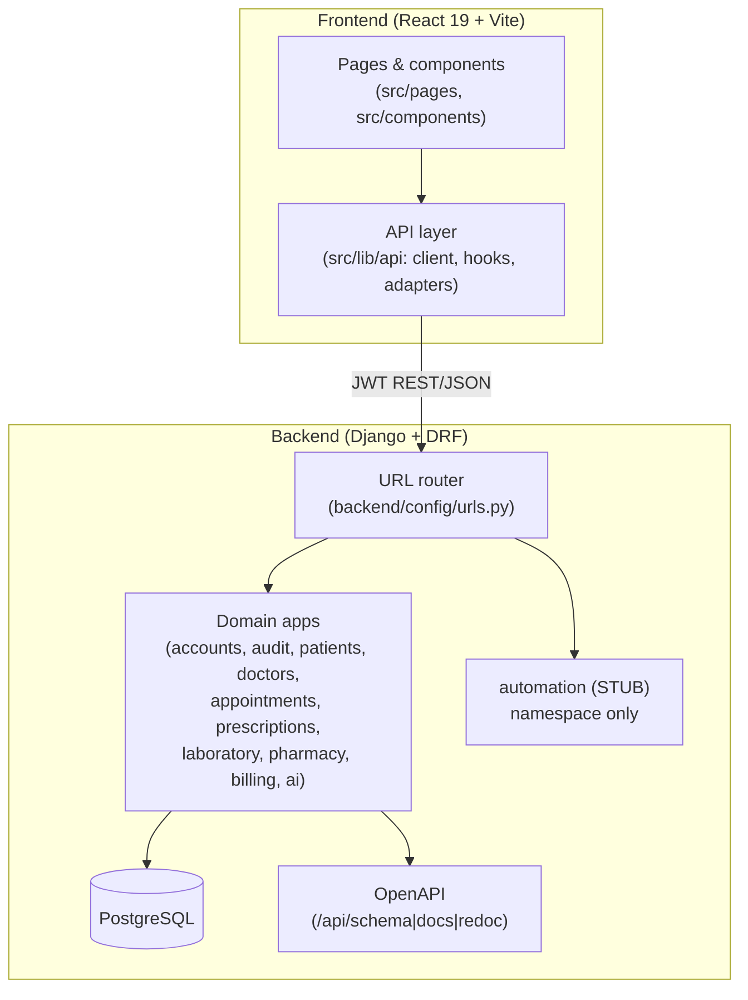
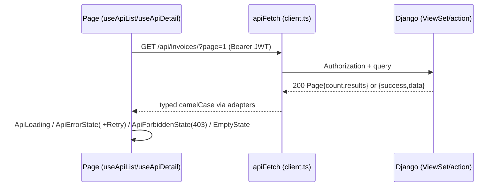
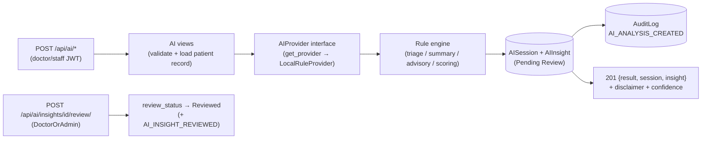
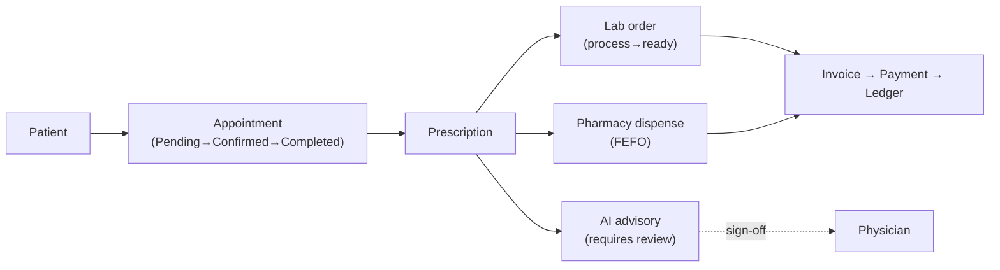

# Architecture — AI-Powered Smart Hospital

> Verified against source on `rony-dev` @ `d81e243` (Oct 2026).
> Every path below was read from the repo. Status labels:
> **Implemented** (code + routes + tests), **Partial** (some layers missing),
> **Stub/Planned** (namespace only). No invented services.

## 1. System Overview

Monolith-friendly two-tier system:

- **Frontend:** React 19 + TypeScript + Vite (`package.json`), React Router 7,
  Tailwind 3 + Radix primitives, Chart.js. Talks to the backend over REST/JSON.
- **Backend:** Django 4.2+ + DRF (`backend/requirements/base.txt`), SimpleJWT
  + blacklist, `dj-database-url` PostgreSQL, `drf-spectacular` OpenAPI.
- **Database:** PostgreSQL 14+ (only). No SQLite fallback in settings; the
  stray root `dev_local.sqlite3` is not referenced by `base.py`.
- **AI engine:** dependency-free deterministic rule provider
  (`backend/apps/ai/providers.py`, `LocalRuleProvider`). No LLM/ML
  dependencies declared. Provider interface exists for a future hosted model.
- **Automation/realtime:** **Stub** — `backend/apps/automation/` is a
  namespace (`models.py` 1 line, `urls.py` empty); frontend automation screens
  are local simulations with no transport (no WebSocket/SSE/polling).



_Status: all boxes Implemented except `automation (STUB)`._

## 2. Frontend Technology and Entry Points

- `package.json`: `react@19, react-dom@19, react-router-dom@7`,
  `@radix-ui/*` (7), `chart.js + react-chartjs-2`, `tailwind-merge`,
  `class-variance-authority`, `clsx`, `lucide-react@1.49`. Dev:
  `vite@8, typescript~6, oxlint`. No axios, no react-query, no test runner.
- Scripts (verbatim): `dev: vite`, `build: tsc -b && vite build`,
  `lint: oxlint`, `preview: vite preview`.
- Entry: `index.html` → `src/main.tsx` → `src/App.tsx` →
  `src/routes.tsx` (`AppRoutes`). Contexts: `ThemeContext, ToastContext,
  RoleContext (mock roles), AuthContext (JWT + demo fallback)`.
  Stores: `src/store/HospitalStore.tsx` (Phase 2–4 mock data),
  `src/store/AutomationStore.tsx` (Phase 6 simulation, header states
  "frontend-only simulation").

## 3. Frontend Routing and Layout

`src/routes.tsx:63-149` is the route table (~60 routes). Public: `/login`,
`/register`. Everything else nests under
`<RequireAuth><AppLayout /></RequireAuth>` (`:70-76`).

Groups: `/dashboard`; patients/doctors/appointments; prescriptions +
`/medicines` + `/follow-ups`; lab (`/lab*`, legacy alias `/laboratory`);
pharmacy; billing (dashboard/invoices/payments/dues/**claims**/ledger);
AI (7 pages); automation (6 pages); `/notifications`; `/settings`
(placeholder); `*` → `NotFoundPage`.

`RequireRole` (`src/components/auth/RequireAuth.tsx:35-56`) is exported but
**never applied to a route** — documented gap. `NavItem.roles?`
(`src/config/navigation.ts:36`) is never populated.

## 4. State Management

- Server state: hand-rolled `useApiList` / `useApiDetail`
  (`src/lib/api/hooks.ts:16-79`) with page/page_size/totalPages/refresh and
  `errorStatus` for 403 handling. No cache library.
- Auth session: `AuthContext` (JWT in `localStorage`: `smh_access_token`,
  `smh_refresh_token`, `smh_demo_session` fallback).
- Role preview: `RoleContext` (`smart-hospital-role`, 6 mock roles).
- Mock domains: `HospitalStore` (patients/doctors/appointments/billing-claims
  local state), `AutomationStore` (workflows/reminders/queue/events).
- RBAC mirrors in `hooks.ts` (`canWritePrescriptions, canManageLabTests,
  canProcessLabOrders, canManageInventory, canManageBilling, canUseTriage,
  canUseClinicalAI, isStaffRole`) — must be kept in sync with backend
  permissions manually (drift risk, no codegen).

## 5. API Client and Authentication Handling

`src/lib/api/client.ts` (120 lines, verified):

- `API_BASE_URL` from `VITE_API_BASE_URL` (see root `.env.example`),
  default `http://localhost:8000/api`.
- `apiFetch(path, {method, body, auth, retry})`: JSON envelope
  `{success, message, data/errors}`, `Authorization: Bearer <access>`,
  auto `POST /auth/refresh/` retry once on 401, `ApiError(status, errors)`.
- Contract duality: DRF paginated lists return unenveloped
  `Page<T> {count, next, previous, results}` (`common.ts`), while custom
  actions/AI return enveloped `{success, data}` — handled by
  `payload.data ?? payload` (`client.ts:119`).
- Per-domain clients (all in `src/lib/api/`): `auth.ts`, `ai.ts` (8 calls),
  `billing.ts`, `laboratory.ts`, `pharmacy.ts`, `prescriptions.ts`,
  `lookups.ts` (patient/doctor dropdowns), `common.ts`, `hooks.ts`,
  `adapters.ts`. **Missing:** `patients.ts`, `doctors.ts`, `appointments.ts`
  — Phase 2 pages therefore stay mock-backed.

## 6. Data Adapters and Type Conversions

`src/lib/api/adapters.ts` centralizes snake_case→camelCase:
`toFullPrescription, toLabOrder/Test/Result, toMedicine/InventoryItem,
toDispensingRecord, toInvoice/Item/Payment/LedgerTransaction`.
AI types in `ai.ts:6-99` match backend camelCase exactly. Static constants
(`MEDICINE_CATEGORIES`, `AI_SYMPTOM_CATALOG`, `AI_SUGGESTED_QUESTIONS`) stay
in `src/data/` and are legitimately imported — only mock *record* arrays in
`src/data/` are deprecated for live modules.

## 7. Backend Technology and Configuration

- `backend/requirements/base.txt` (9 lines): Django, DRF, simplejwt+blacklist,
  cors-headers, dj-database-url, dotenv, psycopg[binary], drf-spectacular.
  `development.txt` adds nothing except the base include.
- Settings: `backend/config/settings/base.py` (201 lines) —
  `INSTALLED_APPS` lists all 11 local apps (incl. `apps.ai`,
  `apps.automation`), `AUTH_USER_MODEL=accounts.User`, JWT lifetimes,
  `StandardPagination` (20/100) in `config/drf.py`, custom exception
  envelope, explicit `CORS_ALLOWED_ORIGINS`, spectacular
  (`TITLE Smart Hospital API v0.7.0`, enum/tag overrides).
  `production.py` refuses `DEBUG=True`/dev secret.
- Env names only (never values): `SECRET_KEY, DEBUG, ALLOWED_HOSTS,
  DATABASE_URL, CORS_ALLOWED_ORIGINS, AI_PROVIDER` (+ JWT settings).
  Backend `.env.example` documents them; root `.env.example` documents only
  `VITE_API_BASE_URL`.

## 8. Django App Boundaries

```
backend/
  manage.py, config/ (settings/base|production, urls, drf, views.ApiRootView, wsgi/asgi)
  apps/
    accounts/      User(Role×7), JWT views, 11 permission classes, UserViewSet
    audit/         AuditAction (~33) + append-only AuditLog + log_audit()
    patients/      Patient (phone/NID unique, Gender/BloodGroup/Status)
    doctors/       Doctor + DoctorSchedule (unique doctor+day)
    appointments/  Appointment state machine + confirm/complete/cancel actions
    prescriptions/ Prescription + PrescriptionItem (denormalized medicine)
    laboratory/    LabTest + LabOrder + LabOrderItem (process/ready/cancel/results)
    pharmacy/      Medicine + MedicineBatch + DispensingRecord/Item (FEFO, atomic dispense)
    billing/       Invoice(+Item, server totals) + Payment + RevenueTransaction ledger
    ai/            AISession + AIInsight + LocalRuleProvider + 8 endpoints (Implemented)
    automation/    STUB — 1-line models.py, empty urls.py, no migrations/tests
```

Each implemented app owns `models, serializers, views, urls,
migrations/0001 (+ deltas), tests/test_*.py, admin` — no cross-app model
imports except FKs to `patients.Patient` and `settings.AUTH_USER_MODEL`.

## 9. API Conventions and Response Envelopes

- Mounts (`config/urls.py:14-26`): `/api/auth|users|audit|patients|doctors|
  appointments|prescriptions|laboratory|pharmacy|billing|ai|automation/`
  + `/api/` index + `/api/schema|docs|redoc/`.
- Standard ViewSets: paginated lists (`?page=&page_size=&search=&<filters>`,
  ordering `-created_at`), CRUD with role-gated writes, `400` validation,
  `401` unauthenticated, `403` forbidden, `404` unknown FK.
- Custom actions enveloped `{success, message, data}`: invoice
  `issue/cancel/overdue`, payment `cancel` (reversal writes `REFUND` ledger),
  lab `process/ready/cancel/results`, dispensing `dispense/cancel`, AI
  `symptom-check/clinical-summary/clinical-ask/prescription-advisory` (201
  with `{result, session, insight}`), insight `review`.
- Read-only: `audit/` and billing `ledger/` (list/retrieve only).



## 10. Authentication and Authorization

- JWT: `accounts/urls_auth.py` — `register|login|refresh|logout|me/`;
  `urls_users.py` — admin `UserViewSet` with self-deactivate/delete guards.
  Frontend stores tokens in localStorage, refreshes silently, falls back to
  demo session when the backend is unreachable (login page "Continue with
  demo access").
- Backend RBAC (`accounts/permissions.py`, 11 classes, single source
  `Role`): `IsSuperAdmin, IsDoctor, IsNurse, IsReceptionist, IsPharmacist,
  IsPathologist, IsPatient, IsDoctorOrAdmin, IsStaffUser (staff or
  non-patient), IsMedicalStaff (doctor/nurse/admin), IsFrontDesk
  (nurse/receptionist/admin)`. Representative wiring: patients read
  `IsAuthenticated`/write `IsStaffUser`; prescriptions write
  `IsDoctorOrAdmin`; pharmacy inventory `SuperAdmin|Pharmacist`; AI triage
  `Medical|FrontDesk`, clinical/advisory/review `DoctorOrAdmin`,
  no-show/analytics/sessions/insights `Staff`.
- Frontend mirrors in `hooks.ts` gate buttons only — **no route enforcement**
  (gap tracked as `RBAC-01` in `workflow.md`).

## 11. Database and Model Relationships

Core relations (FKs, verified in `models.py` files):

- `Patient` ← `Appointment` (patient+doctor+scheduled_at, unique active slot;
  Cancelled excluded so slots are reusable), `Prescription`, `LabOrder`,
  `Invoice`, `AISession`.
- `Doctor` ← `DoctorSchedule`, `Appointment`.
- `Prescription` ← `PrescriptionItem`; `LabOrder` ← `LabOrderItem`;
  `Medicine` ← `MedicineBatch` (expiry), `DispensingRecord` ←
  `DispensingItem` (FEFO allocation); `Invoice` ← `InvoiceItem`,
  `Payment` (→ reversal `Payment`, → immutable `RevenueTransaction`).
- `AISession` ← `AIInsight` (CASCADE); `reviewed_by` → User (SET_NULL).
- `AuditLog.user` → User (SET_NULL, nullable) + `object_type/object_id`
  free reference — no FK so logs survive deletion.

Money/stock/AI-severity are **server-derived**, never trusted from the
client: invoice subtotal/total/paid/due/overdue, medicine
`current/available/expired/is_low_stock`, triage level + confidence,
no-show score (base10 + lead-time + type + history + hour, clamped 5–95).

## 12. Migration Conventions

One `migrations/0001_initial.py` per implemented app (+ `pharmacy/0002`,
`audit/0002-0005` action-enum extensions, `ai/0001`). `automation/` has no
`migrations/` package (stub). Convention: generate with
`python manage.py makemigrations`, validate with `migrate --check` adjacency
and `manage.py check`, apply with `migrate` — never fake or reset (see
`workflow.md`). The four successive `alter_auditlog_action` migrations should
be squashed before production.

## 13. Audit Logging

`apps/audit/models.py`: `AuditAction` TextChoices (~33:
`LOGIN/LOGOUT/USER_*`, `PATIENT_*`, `DOCTOR_*`, `APPOINTMENT_*`,
`PRESCRIPTION_*`, `LAB_*`, `MEDICINE_*/BATCH_*/DISPENSING_*`,
`INVOICE_*/PAYMENT_*`, `AI_ANALYSIS_CREATED`, `AI_INSIGHT_REVIEWED`) +
`AuditLog(uuid, user, action[30], module[50], object_type/object_id,
description, ip, created_at)`, ordering `-created_at`. Views are
`ReadOnlyModelViewSet`, `IsSuperAdmin`-only (`audit/views.py`). Writes go
through `audit/utils.py: log_audit()` + `get_client_ip()` from every module
view, including AI `_audit_analysis` and insight `review`. Admin is read-only.

## 14. Pagination, Filtering, Search

`config/drf.py: StandardPagination` (page_size 20, max 100). List endpoints
accept `page/page_size/search` plus domain filters: patients
(status/gender/blood), appointments (status/date/doctor), lab
(status/test), pharmacy (stock_status/expiry), invoices (status/overdue),
payments (invoice/method), AI insights (`module/review_status/search`),
sessions (`module/patient`). Frontend `useApiList` drives page controls via
`DataPagination.tsx`.

## 15. OpenAPI Documentation

`drf-spectacular>=0.27` (`DEFAULT_SCHEMA_CLASS=AutoSchema`,
`SPECTACULAR_SETTINGS` title `Smart Hospital API v0.7.0` with 14 enum
overrides incl. `AIModule/AIInsightKind/AIReviewStatus`, 13 tags).
Routes: `/api/schema/` (JSON), `/api/docs/` (Swagger), `/api/redoc/`
(ReDoc), plus `ApiRootView` index (`config/views.py`). Covered by
`accounts/tests/test_api_root.py`.

## 16. AI Service / Provider Architecture (**Implemented** as rule engine)

`backend/apps/ai/`: `models.py` (`AISession`: module/patient/requested_by/
input_data/provider/created_at; `AIInsight`: session/kind/title/content/
confidence/requires_review=True/review_status=Pending→Reviewed/reviewed_by/
at/note), `providers.py` (`AIProvider` interface:
`triage/clinical_summary/clinical_answer/prescription_advisory`;
`LocalRuleProvider(name=local)` 370 lines: keyword+severity+vitals triage
with 4 levels + disclaimer; record-grounded summary/answer templates; 5
interaction pairs + allergy/duplicate/dose advisory), `serializers.py`
(request/response + `InsightReview`), `views.py` (498 lines: 4 POST analysis
views persisting session+insight+audit; `NoShowPredictionView` +
`HealthAnalyticsView` live reads without persistence; `AISessionViewSet` +
`AIInsightViewSet` with doctor-only `review` action), `urls.py` (4 POST +
2 GET + router `sessions|insights`), `migrations/0001`, `tests/test_ai.py`
(227 lines, 14 cases). Mounted at `/api/ai/`; enums registered for
spectacular (`settings/base.py:182-184`); audit actions added via
`audit/migrations/0005`.

`get_provider()` (`providers.py:363-370`) reads `AI_PROVIDER` but **always
returns `LocalRuleProvider`** — unknown names degrade safely. No AI
third-party packages in requirements (verified 0 hits for
openai/anthropic/numpy/sklearn/torch).



Clinical-safety boundary: content is immutable advisory; only `review_*`
fields change, only via explicit physician sign-off; no-show/analytics are
read-only aggregates; `COMPLETED` enum value is currently never written
(known gap).

## 17. Automation / Realtime Architecture (Actual Status: **Stub**)

Intended (not built): persisted reminders/alerts/queue + WebSocket/SSE or
polling + background jobs + email/SMS providers. Actual: backend namespace
only (`models.py` 1 line, `urls.py` empty, no migrations/tests, mounted but
inert at `/api/automation/`); frontend `src/pages/automation/*` (6 pages) +
`src/components/automation/*` (9) + `AutomationStore` simulate realtime via
`setInterval` (queue auto-advance 8s) and fixed `SIM_TIME`. Zero socket
client, zero backend polling (verified grep). Document as simulation until
the backend lands — do not present queue/notifications as live.

## 18. Error Handling

Backend: `config/drf.py custom_exception_handler` normalizes to
`{success:false, message, errors}`; domain serializers raise field-level
`400`s (empty symptoms, unknown patient → 404, double-review → 400,
overpay/draft-pay → 400). Frontend: `ApiError` → `ApiState` blocks with
Retry; 403 → `ApiForbiddenState`; unreachable backend → "Backend is
unreachable" message; auth 401 → silent refresh → login redirect.

## 19. Testing Strategy

Backend: `backend/apps/*/tests/test_*.py` (12 files, `APITestCase`) —
auth/permissions/api-root/audit/patients/doctors/appointments/
prescriptions/laboratory/pharmacy/billing(20 cases incl. totals/reversals/
ledger)/ai(14 cases incl. RBAC/triage/advisory/review). Run with
`python manage.py test` (see `workflow.md`); historical results only, none
re-executed in this docs task. Frontend: **no tests, no runner** — meaningful
frontend tests are a roadmap item (`FINAL-0x`), not to be added casually.

## 20. Environment Configuration (Names Only)

Frontend (root `.env.example`): `VITE_API_BASE_URL`.
Backend (`backend/.env.example` + `settings/base.py`): `SECRET_KEY, DEBUG,
ALLOWED_HOSTS, DATABASE_URL, CORS_ALLOWED_ORIGINS, AI_PROVIDER` (+ JWT
lifetimes). Never commit `.env`; never print values (this doc lists names
only).

## 21. Security Boundaries

Trust boundary is the DRF permission layer: every write endpoint requires a
composed `permissions.py` class; patients can never reach staff endpoints;
audit/log and user admin are super-admin-only; ledger/audit are read-only;
payments/dispensing run in atomic locked transactions; review requires
`IsDoctorOrAdmin` with idempotency. Frontend gating is cosmetic. Secrets stay
in env; tokens in localStorage (XSS-sensitive — no inline secrets in docs).

## 22. Important Architectural Limitations

1. Phase 2 frontend unwired (no patients/doctors/appointments clients).
2. Claims backend absent; automation backend absent; realtime transport absent.
3. AI is rules-only; `AI_PROVIDER` currently a no-op selector.
4. RBAC enforced in backend only; frontend `RequireRole`/nav roles unused.
5. Dual response envelope (paginated vs enveloped) handled by convention.
6. PostgreSQL-only; no async workers/Channels configured.
7. Audit-enum migration churn (4 alters) needs squash.

## 23. Recommended Future Architecture Changes

- Wire Phase 2 clients + adapters (no new stack).
- Implement Claims **or** formally descope (product decision first).
- Implement automation persistence + choose SSE/polling vs Channels (one
  transport, not both); background jobs only if reminders require them.
- Add LLM provider behind `AIProvider` only with approval + secrets + tests
  + fallback (keep local default).
- Centralize status-badge mapping; generate frontend role helpers from
  backend `Role` (or document sync); squash audit migrations; add frontend
  test runner only when a real suite is committed.

## 24. Required Diagrams Checklist

1. High-level system architecture — §1 (Implemented except automation stub).
2. Frontend-to-backend request flow — §9 (Implemented).
3. Main hospital workflow — below (Implemented except claims/automation legs).



4. AI advisory + physician-review flow — §16 (Implemented, rules engine).
5. Git collaboration flow — see `workflow.md` §5 (Implemented convention).
